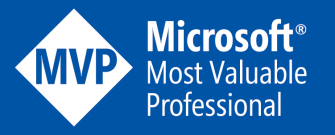
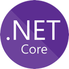
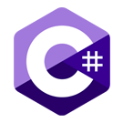
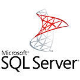

[[imgBadge]]
| 

[[imgBadge]]
| 

[[imgBadge]]
| 

[[imgBadge]]
| 

[[imgBadge]]
| 

[[imgBadge]]
| 

[[imgBadge]]
| 

[[imgBadge]]
| 

[[imgBadge]]
| 

---

Gordon Beeming is a Solution Architect at SSW and a Microsoft MVP in Developer Technologies, an award he has held since 2014. He helps teams adopt DevOps practices, working through the changes to both their tools and the way they work.

He has worked with the Microsoft stack since .NET 2.0 in 2008 and with Azure DevOps since its early days as on-premises TFS. Gordon has co-authored books on TFS and agile project management. A former ALM Ranger, he also contributed to community guidance.

Based in Brisbane, Australia, Gordon shares his knowledge and current projects on his [YouTube channel](https://www.youtube.com/@gordonbeeming). Outside work, he enjoys training for triathlons and spending time with his family.

Connect with Gordon through his [social platforms](https://gordonbeeming.com/about).
