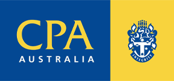

[[imgBadge]]
| 

I’m a Senior Accountant at SSW, where I handle management reporting and cash flow forecasting. I work with our Financial Controller to help the team understand how the business is performing and plan what we can commit to in the months ahead.

I designed and implemented our month-end closing rules to give the finance team a consistent process to follow. We use Fathom to present our management reports, and Xero is our source of truth for reconciliation and payroll.

I also work on TimePro, our invoicing and timesheeting system, which integrates with Xero. My focus is making the data more accurate and consistent. I’ve led the rollout of new features in TimePro, including credit notes, logic for handling deferred income, and EasyLeave, our leave management system.

Outside work, I enjoy reading and playing strategy board games, especially Blood on the Clocktower.
